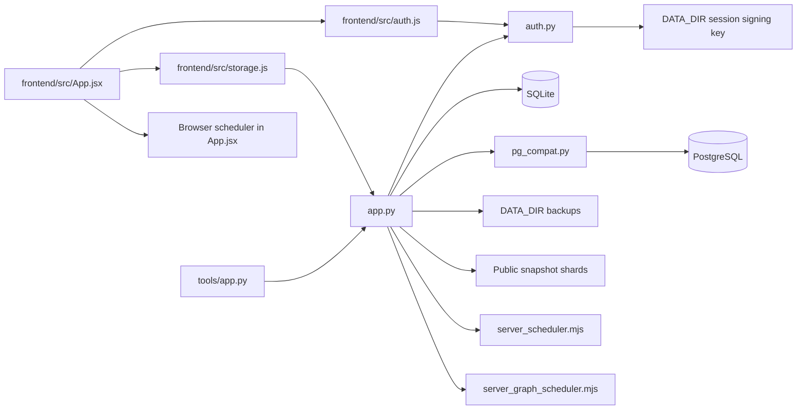
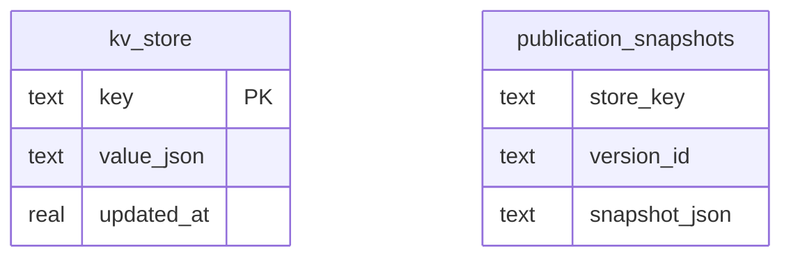
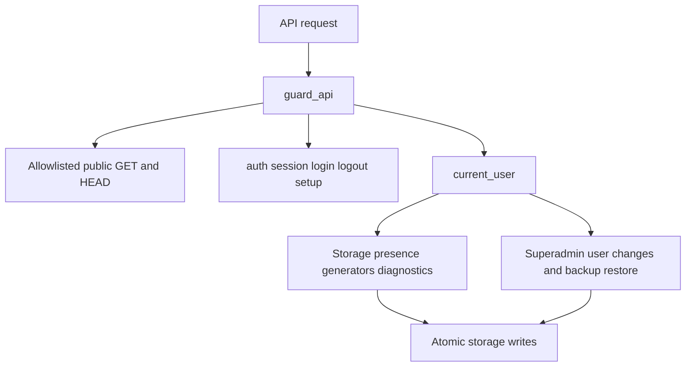
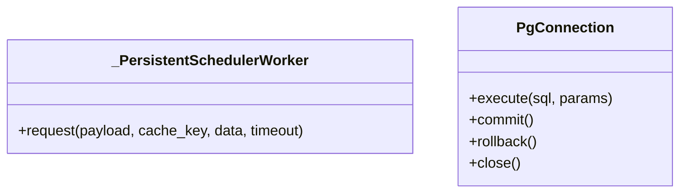

# UML проекта timetable22

Обновлено: 2026-11-06 — серверная авторизация и единая точка входа API.

## Компоненты

## Хранение

Рабочий проект и пользователи находятся внутри JSON `schedule-data-v2`.
Точные дополнительные поля и индексы определяются инициализацией в `app.py`.
SQLite и PostgreSQL используют совместимый слой `pg_compat.py`.

## API и контроль доступа

| Маршрут | Назначение |
| --- | --- |
| GET /api/auth/session | Состояние входа без списка пользователей |
| POST /api/auth/login | Серверная проверка пароля |
| POST /api/auth/logout | Удаление cookie входа |
| POST /api/auth/setup | Первый администратор по AUTH_SETUP_TOKEN |
| POST /api/auth/password | Смена собственного пароля |
| GET /api/public-* | Опубликованные данные по явному списку |
| /api/storage* | Закрытый редакторский контур |
| /api/schedule/*, /api/graphs/* | Закрытые серверные планировщики |

Сессия подписана постоянным ключом. Пароль и роль сверяются с хранилищем на
каждом закрытом запросе. Клиентский ID пользователя не даёт полномочий.

## Классы

Архивные исходники в `tools/frontend/` не участвуют в основной Docker-сборке.
